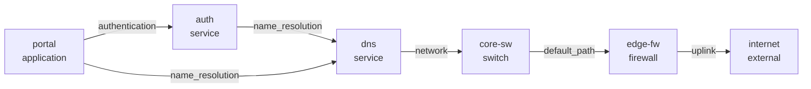

# InfraGraph

Build infrastructure dependency graphs, calculate failure blast radius, and find single points of failure before an outage does.

InfraGraph models a simple but operationally useful relationship: **source depends on target**. From that inventory it can answer:

- What breaks if this switch, service, site, database, or provider fails?
- Which critical systems are transitively affected?
- Why is a service affected?
- Which nodes are single points of failure?
- What does the dependency topology look like?

## Quick start

```bash
pip install -e ".[dev]"
infragraph examples/campus.json impact core-sw
```

Example output:

```text
Failed: core-sw
Impacted (3): auth, dns, portal
Critical impacts: auth, dns, portal
  auth: auth -> dns -> core-sw
  dns: dns -> core-sw
  portal: portal -> dns -> core-sw
```

Each path is the shortest chain from the impacted node to the failure.

## Commands

```bash
# Calculate failure blast radius
infragraph inventory.json impact edge-fw core-sw

# Machine-readable report
infragraph inventory.json impact edge-fw --json

# Show everything a node depends on
infragraph inventory.json chain portal

# Find nodes whose loss affects critical services
infragraph inventory.json spof

# Export a Mermaid diagram
infragraph inventory.json mermaid -o topology.mmd
```

### Exit codes

| Code | Meaning |
|------|---------|
| `0`  | Success: no critical impact and no single point of failure |
| `1`  | Critical impact found (`impact`), or any single point of failure found (`spof`) |
| `2`  | Bad inventory or unknown node |

Codes `1` and `2` make the CLI usable as a maintenance check or CI policy gate.

## Inventory format

```json
{
  "nodes": [
    {"id": "core-sw", "kind": "switch", "criticality": "high"},
    {"id": "dns", "kind": "service", "criticality": "critical"}
  ],
  "dependencies": [
    {"source": "dns", "target": "core-sw", "kind": "network"}
  ]
}
```

Node fields:

| Field | Default | Notes |
|-------|---------|-------|
| `id` | required | Unique node ID |
| `kind` | `"service"` | Shown in the Mermaid label |
| `label` | `null` | Display name; falls back to `id` |
| `criticality` | `"medium"` | Only `"critical"` counts towards critical impacts and `spof` |
| `metadata` | `{}` | Free-form object, carried through untouched |

Dependency fields:

| Field | Default | Notes |
|-------|---------|-------|
| `source` | required | The node that depends on `target` |
| `target` | required | The node being depended on |
| `kind` | `"depends_on"` | Shown as the Mermaid edge label |
| `required` | `true` | Set to `false` for an optional dependency |

Dependencies are directional: `dns -> core-sw` means DNS requires the core switch. Optional dependencies (`required: false`) are drawn dashed and do not propagate failure. Unknown fields are rejected.

## Topology example

`infragraph examples/campus.json mermaid`:



## Python API

```python
import json
from pathlib import Path

from infragraph import build_graph

graph = build_graph(json.loads(Path("inventory.json").read_text()))
report = graph.blast_radius("core-sw")
print(report.critical_impacts)
print(report.to_dict())  # the same structure `impact --json` prints
```

## Development

```bash
pip install -e ".[dev]"
pytest
ruff check .
```

The tests import the installed package, so run the editable install first; bare `pytest` from a clean checkout fails with `ModuleNotFoundError: infragraph`.
